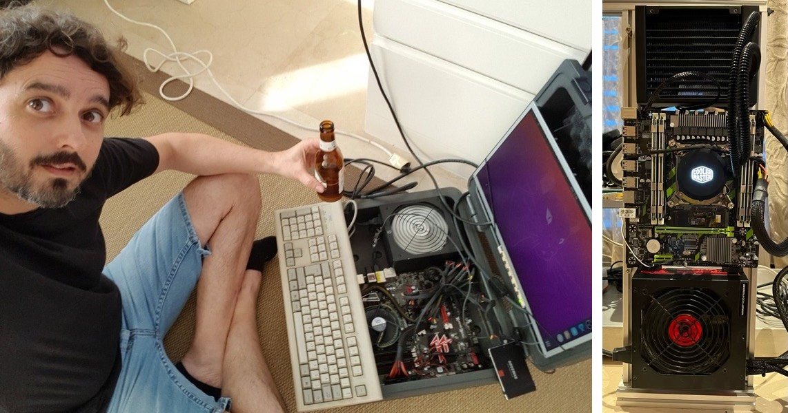

# Selfhosted

> To become independent, you don't have to  ask for independence. To become independent you have **to be** independent.

This is the story of how I am slowly becoming independent. Disclaimer: If you don't understand anything, that's fine. I created this documentation for myself.

## Why am I doing this

My name is Francisco, in french it means "free person" . Some people in life want performance, some other want reliability. The only thing I care about is freedom. To do what I want, when I want and how I want to.

## Current infrastructure

**Server:** Intel NUC 11, 16 GB RAM, 1 TB NVMe. Ubuntu Server. Connected via 1 Gbps symmetric FTTH (dynamic IP). The Razer Core X eGPU is used as a **job session**, not always-on: long continuous attach (including idle) has hard-hung the host. Power it for Whisper/TTS/ComfyUI work, then power it off and reboot; see [GPU services / eGPU sessions](doc/gpu-services.md#egpu-session-model-required-for-host-stability) and [GPU setup](doc/gpu.md).

**NUC Tailscale (verified 2026-10-08):** `thebeachlab` joined the GitHub tailnet
`thebeachlab.github`, replacing its previous client login to Headscale at
`https://hs.beachlab.org`. Its control server is now
`https://controlplane.tailscale.com`, MagicDNS name
`nuc.tail520737.ts.net`, and IPv4 address `100.91.63.61`.
`tailscaled` is enabled and active. The `192.168.1.0/24` subnet advertisement
was removed with `sudo tailscale set --advertise-routes=`; the NUC now
advertises no subnet routes. Access the NUC using its Tailscale address.
Source: live NUC `tailscale status --json`, `tailscale debug prefs`,
`systemctl is-enabled tailscaled`, and `systemctl is-active tailscaled`;
Mac `tailscale ping 100.91.63.61`
and successful OpenSSH access to `100.91.63.61:622` with the existing host key.

**RPi 5 (pibot1):** Mounted in the G Mobile Lab (vehicle). Its recorded job is the Bluetti BLE bridge, I2C sensors (CO2, temp, humidity, pressure), GPS NEO-6M, IMU MPU-6050, and Starlink gRPC telemetry, with the path to the server written as Starlink + Tailscale. On 2026-09-12 the Pi's SSH endpoint timed out and the stored attitude was a repeated cache. The server ingest written after that left the Pi's power and connection state unverified. See [Bluetti telemetry](doc/bluetti-telemetry.md) and [pibot1](doc/rpi.md).

**NAS:** Synology DS411slim, DSM 6.2.4-25556 Update 8. See
[NAS access and Tailscale compatibility](doc/nas.md) for the verified configuration
and the legacy kernel's package requirements. Named shares are on that page.

**Grok Bot box (verified 2026-11-01):** Fran's AI assistant Linux machine.
`grokbot-box` is on the GitHub tailnet at `100.65.1.62` (Tailscale 1.104.4
static binaries, no systemd). Its ed25519 key logs in to the NUC, the
Liderflor VPS, pibot1, the NAS and lider-server. laborpc-1 and x220 were
offline, so the key is not there yet. See [grokbot-box](doc/grokbot-box.md).

**Liderflor VPS:** A separate host from the NUC, the NAS and the Pi. [Node.js](doc/nodejs.md)
and [security maintenance](doc/security.md) record Flora OpenClaw there, plus a
public WordPress site, API and shop. `liderflorapi.beachlab.org` is a fixed
DNS record ([Cloudflare DNS](services/cloudflare-ddns/README.md)).

**Remote access today:** The NUC, the NAS and grokbot-box are on the GitHub
tailnet, as written above. When checked on 2026-10-08 the NUC client had left
Headscale at `https://hs.beachlab.org`. [Headscale](doc/headscale.md) still
records that server running on the NUC on 2026-10-26, with client IDs 1 and 2
kept.
[OpenVPN](doc/vpn.md)'s server unit was restarted the same day
([security](doc/security.md)). The [WireGuard](doc/wireguard.md) page is the
hub setup guide; the Pi's recorded path is Tailscale. Who still uses
Headscale, OpenVPN or WireGuard is an open question below.

**Previous servers (non-operational):**

- *Suitcase* — 2015 Skylake i3-6100, 8 GB RAM, 500 GB SSD
- *Sister* — X79 Xeon E5-2670 v2 (10c/20t), 40 GB RAM, 1 TB NVMe

## TOC

### Server setup

- [Getting started](doc/getstarted.md)
- [Securing SSH access](doc/security.md)
- [Backups](doc/backups.md)
- [Web server (Nginx)](doc/web.md)
- [Hariburi currency rates](doc/hariburi-rates.md)
- [Cloudflare DNS and NUC dynamic IP updates](services/cloudflare-ddns/README.md)
- [Passkey access (Authentik)](doc/authentik.md)
- [Service administration](doc/admin-panel.md)
- [Git server](doc/git.md)
- [SFTP server](doc/sftp.md)
- [Headscale](doc/headscale.md) (server on the NUC as of 2026-10-26; NUC client uses the GitHub tailnet)
- [Grok Bot box](doc/grokbot-box.md) (on the GitHub tailnet as of 2026-11-01)
- [VPN Server (OpenVPN)](doc/vpn.md) (unit restarted 2026-10-26; daily use not recorded)
- [WireGuard VPN](doc/wireguard.md) (setup guide; no later check that it still runs)
- [Server Safeguards (resource limits + alerts)](doc/server-safeguards.md)
- [Troubleshooting](doc/troubleshooting.md)

### Services

- [Small-space housing podcast](services/podcast/README.md)

- [Das Werklab voice receptionist (ES/EN/DE)](doc/daswerklab-voice.md)
- [Vaultwarden password manager](doc/vaultwarden.md)
- [Buchhaltung: repositorio propio privado](doc/buchhaltung.md)
- [Msgvault communications archive](doc/msgvault.md)
- [Taskwarrior and Nextcloud Tasks sync](doc/taskserver.md)
- [Transmission Daemon (NordVPN)](doc/transmission.md)
- [Mumble voice server](doc/mumble.md) (setup guide; no later check that it is running)
- [iOS Push Notifications (iGotify)](doc/igotify.md)
- [Drop (protected URL downloads)](doc/drop.md)
- [Remote browser](doc/browser.md)
- [n8n automation](doc/n8n.md) (removed 2026-02-08)
- [Auto USB copy](doc/transfer2usb.md)
- [Node.js / PM2](doc/nodejs.md)
- [OpenClaw TUI Quick Access (tmux)](doc/openclaw-tui.md)
- [OpenClaw runtime maintenance](doc/watson-openclaw-runtime.md) (how Watson is updated; what the agent is for is not written here)

### Monitoring

- [Grafana (TimescaleDB dashboards)](doc/grafana.md)

### IoT and telemetry

- [IoT (Mosquitto MQTT)](doc/iot.md)
- [MQTT Telemetry — server stats (alpha/stats)](doc/mqtt-telemetry.md)
- [MQTT to TimescaleDB and PostgREST](doc/mqtt-timescale-postgrest.md)
- [Bluetti Mobile Lab telemetry pipeline](doc/bluetti-telemetry.md)
- [Raspberry Pi 5 (pibot1)](doc/rpi.md)

### Databases and APIs

- [PostgreSQL](doc/postgres.md)
  - [TimescaleDB](doc/timescaledb.md)
  - [Strapi CMS](doc/strapi.md) (install guide; `sisterapi` is not in the current database list)
  - [PostgREST API](doc/postgrest.md)
  - [PostgREST JWT Gateway](doc/postgrest-jwt.md)

### AI and GPU

- [Personal knowledge: Strategy, sources and recovery](doc/personal-knowledge.md)
  - [Obsidian](doc/obsidian.md)
- [Knowledge graphs and agent loops](doc/knowledge-graphs.md) (experiments; LangGraph, Graphiti and Neo4j are not deployed on the NUC)
  - [LangGraph](doc/langgraph.md)
  - [Graphiti](doc/graphiti.md)
  - [Neo4j Community and Browser](doc/neo4j.md)
  - [Graph tools](doc/graph-tools.md)
- [GPU setup](doc/gpu.md)
- [GPU Service Management (on-demand Whisper/RAG/TTS)](doc/gpu-services.md)
- [Whisper Web (protected upload + diarization)](doc/whisper.md)
- [eBook RAG (SFTP Inbox)](doc/rag-library.md)
- [Qwen3-TTS Voice Cloning (multilingual)](doc/qwen3-tts.md)
- [ComfyUI (Stable Diffusion node editor)](doc/comfyui.md)
- [Hailo AI dataflow compiler](doc/ai.md)

### WIP / archived

- [Understanding DNS](doc/dns.md) (WIP; not the current public DNS)
- [OBS ninja (WebRTC)](doc/obsninja.md) (WIP; public exposure removed 2026-02-08)
- [STUN/TURN Server](doc/turn.md) (WIP; public coturn exposure removed 2026-02-08)
- [Minecraft server](doc/minecraft.md)
- [Nextcloud](doc/cloud.md)
- [Mail server (Postfix)](doc/mail.md) (Postfix disabled, recorded 2026-02-08; Dovecot and OpenDKIM never written up)
- [openHAB (BTicino/OpenWebNet and Apple Home)](doc/openhab.md)

## Open questions

Unanswered in the repo:

- Whether the scheduled Namecheap ddclient retirement finished. [Cloudflare DNS](services/cloudflare-ddns/README.md).
- Whether gitweb at `git.beachlab.org` is still served, and whether the NUC still listens on SSH port 22222 (verified admin access is port 622). [Git](doc/git.md), [SSH](doc/security.md).
- Which database uses PostGIS; the table lists behind the short database names; whether `air` and `sisterapi` exist. [PostgreSQL](doc/postgres.md).
- Who Headscale clients 1 and 2 are, and whether anyone still uses Headscale, OpenVPN or WireGuard day to day. [Headscale](doc/headscale.md), [OpenVPN](doc/vpn.md), [WireGuard](doc/wireguard.md).
- Whether a house sensor replaced the Sitges Open-Meteo readings after 2026-09-12. [Telemetry columns](doc/mqtt-timescale-postgrest.md).
- Whether the vehicle Pi is online now. [pibot1](doc/rpi.md).
- Whether Mumble at `walkie.beachlab.org` is running. [Mumble](doc/mumble.md).
- What Deutsch Sprint is. [Authentik](doc/authentik.md).
- TiTiler's public hostname, and which maps it serves. [Administration](doc/admin-panel.md).
- What the Watson OpenClaw agent is for. [Runtime maintenance](doc/watson-openclaw-runtime.md).
- What `/data/` on `api.beachlab.org` used to target, and what the pending `/air/` setup is. [Safeguards](doc/server-safeguards.md).
- Which NAS volumes exist besides the backup paths named in the docs, and whether those two backup paths are the same share. [NAS](doc/nas.md).
- Why port 22 on the NAS Tailscale IP answers SSH with the same ed25519 host key as the documented DSM port 22222, and rejects the `unix` key. [NAS](doc/nas.md).

## Mebuko

The multilingual bookkeeping launch page has its own public service, email
confirmation list and private encrypted backups. It is separate from the
owner-only accounting application. See [Mebuko deployment and privacy](doc/mebuko.md)
and the [visual specification](services/mebuko/DESIGN.md).
