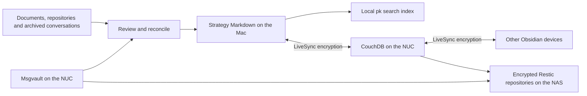

# Personal knowledge: Strategy

Strategy is Fran's maintained knowledge graph. Its source of truth is the
linked Markdown in `/Users/Papi/Repositories/project-knowledge/vaults/strategy/`,
starting at `Fran.md`, then `Personal` or `Work`. Obsidian displays these files;
agents read and edit the same files. There is no separate authoritative profile
in agent memory, Msgvault, a search index or Neo4j.

## How the pieces connect



Importing mail makes it searchable; it does not automatically turn its contents
into micronotes. Relevant facts are compared with existing notes and incorporated
through an explicit edit. Original messages and documents remain available for
checking a claim. Old plans and third-party statements do not establish current
facts by themselves.

The Mac is the agents' normal entry point, not a device that always wins sync
conflicts. LiveSync exchanges edits and deletions between participating devices.
The mobile onboarding files are prepared; a connected phone has not yet been
confirmed. [Obsidian](obsidian.md) covers adding and checking a device.

## Where everything lives

| Material | Location and role |
| --- | --- |
| Maintained notes | Mac: `/Users/Papi/Repositories/project-knowledge/vaults/strategy/` |
| Source catalogue | Same repository: `catalogues/strategy-sources.json`; maps notes to originals, message IDs and private exports |
| Private working data | Mac: `/Users/Papi/Library/Application Support/ProjectKnowledge/`; includes search data, review exports, local database files and credentials |
| Mail archive | NUC: `/var/lib/msgvault/`; SQLite, attachments and account configuration |
| Encrypted sync replica | NUC: `/var/lib/obsidian-sync/`; CouchDB database `strategy`, served through `https://api.beachlab.org/obsidian-sync` |
| Server backups | NAS: `/volume1/synology/backups/`, mounted on the NUC at `/mnt/nas-downloads/backups/` |

Linked originals also live outside these directories: in `Documents`, other
repositories and NAS folders. A catalogue entry or a `file://` link does not
copy its target into the vault. Local absolute links may work on the Mac but
cannot make those documents available on a phone.

Private notes stay in the vault's private sections. Their visibility labels are
organisational metadata, not access controls. A device receiving the whole vault
also receives its private notes. Passwords, tokens and private keys belong in
private configuration or credential storage, never in notes or Git.

## Reading and updating the graph

```bash
cd /Users/Papi/Repositories/project-knowledge
pk query strategy 'PiBot CAN hardware' --documents-only
```

Read the returned Markdown and follow its links. If the query misses a topic,
search the vault directly with `rg`, including exact names and synonyms.
Agents' global instructions point to this path even when their current project
is elsewhere; a remote agent without Mac filesystem access must report that
limitation instead of creating another vault.

Reuse the note for the subject. Write short English micronotes and link distinct
subjects from the relevant Personal or Work branch. Replace superseded statements
with the current state; Git keeps edit history. Past jobs, completed projects,
maintenance records and other purposeful histories retain their historical facts.
Keep source details in the catalogue and brief source links in the notes.

Each `pk query` refreshes the curated note index, including edits, renames and
deletions. Strategy's index is
`~/Library/Application Support/ProjectKnowledge/strategy/ingestion/documents.sqlite3`.
It is derived data, not a backup. Markdown search does not require a running
Neo4j server or a model. `pk ask` additionally passes retrieved text to Codex
through the configured ChatGPT session, so selected private passages can be
included in that request.

The separate Graphiti/Neo4j pilot runs through the Mac's `project-knowledge`
Colima profile. Its derived episodes do not override Strategy's curated notes.
Hariburi has its own vault and database; its generated `Fuentes/` pages remain
read-only. See [knowledge graphs and agent loops](knowledge-graphs.md) for the
experimental components.

## What is backed up

The NUC backs up the graph from CouchDB's **`strategy` database**, which holds
LiveSync's encrypted representation of the vault. It captures the files that
have reached the server, together with the database users, configuration and
deployment files needed to restore the service. Note links are part of the
Markdown and return with the notes.

```text
NUC live data:       /var/lib/obsidian-sync/
NUC capture/state:   /var/lib/obsidian-sync-backup/
Versioned backup:   /mnt/nas-downloads/backups/obsidian-sync-restic
NAS native path:    /volume1/synology/backups/obsidian-sync-restic
```

The NUC creates the backup; the NAS stores the encrypted versions. The local
`payload/` directory is staging for the most recent capture and is replaced on
the next run. It is not the retained snapshot history.

`obsidian-sync-backup.timer` runs daily at **02:55 Europe/Madrid**, with up to
five minutes of delay. The script briefly stops only `obsidian-couchdb`, copies
its data and configuration, restarts it, then writes the capture through Restic.
Retention is **7 daily, 4 weekly and 6 monthly snapshots**. It checks the expected
NAS mount and repository identity before writing.

LiveSync continuously changes the server replica as devices synchronise. Restic
provides earlier recovery points if notes are deleted or corrupted, or the NUC
fails. Changes still waiting on a device are not in a server backup: the recovery
point is the data present when CouchDB was captured.

### Check the graph backup

```bash
ssh pink-sudo
systemctl list-timers obsidian-sync-backup.timer
systemctl show obsidian-sync-backup.service -p Result -p ExecMainStatus
sudo cat /var/lib/obsidian-sync-backup/last-success.json
```

In a root Bash shell on the NUC, list the snapshots that actually exist on the
NAS:

```bash
export RESTIC_PASSWORD_FILE=/root/.config/thebeachlab-backup/restic-password
restic -r /mnt/nas-downloads/backups/obsidian-sync-restic snapshots --tag obsidian-sync
```

Match the successful receipt's snapshot ID to this list. Its `files` field counts
physical database and configuration files, not individual notes. `restored: false`
means that run did not include the optional restore test; it does not mean the
backup failed. The [Obsidian runbook](obsidian.md#backups-and-recovery) explains
how to run that test and inspect a failed service.

### Keys and backup coverage

Restic uses `/root/.config/thebeachlab-backup/restic-password`, with a recovery
copy at `/mnt/nas-downloads/backups/thebeachlab-restic-password`, protected by
NAS share permissions. This opens the backup repository.

Reading the recovered notes also requires the separate **LiveSync encryption
key** held by the devices. The private setup file is
`/Users/Papi/Library/Application Support/ProjectKnowledge/obsidian-sync/mobile-connection-private.txt`.
The server backup includes CouchDB account credentials but not this note key.
Keep the key available for recovery without placing it in the vault or Git.

The graph backup covers the synced vault. Linked external documents, the source
catalogue, Git history and the Msgvault mail archive are separate material.
[Msgvault's own backup](msgvault.md#storage-and-encrypted-backups) runs on the NUC
at 02:30 Europe/Madrid and writes to `msgvault-restic` on the same NAS. It restores
the underlying mail and attachments, rather than the maintained notes.

`pk backup strategy` belongs to the separate local Neo4j pilot. It does not run
this CouchDB backup and is not needed to recover the Obsidian graph. The general
NUC backup is also separate from these service-specific captures.

The NAS protects against loss of the NUC's disk. No independent off-site copy of
the NAS repositories has been established.

## Recovering the system

### The NUC or a service database was lost

1. Recover NAS access and the Restic password. Select an explicit graph snapshot
   and restore it into a fresh private directory on the NUC, following
   [Restore CouchDB](obsidian.md#restore-couchdb).
2. Keep Obsidian clients disconnected and preserve their vaults. Stop the backup
   timer and CouchDB, preserve the current server directories, and put the
   recovered data, deployment and credentials in their documented locations.
3. Restore ownership, start CouchDB and check authenticated access through
   `https://api.beachlab.org/obsidian-sync`. Keep the previous directories until
   the recovered service passes validation.
4. Connect a new empty Obsidian vault with the saved device configuration and
   LiveSync encryption key. Fetch the recovered notes, then check `Fran`, its
   links and representative private notes. Reconcile any newer device edits
   before reconnecting other clients.
5. Restore backup operation and confirm the next run succeeds.

This recovers the graph through its NUC service and NAS snapshot. No full Mac
restore is involved. If CouchDB is healthy and only a client vault needs replacing,
use [the new-device procedure](obsidian.md#mac-and-mobile) to fetch the current
server copy.

The graph backup script also requires
`/var/lib/obsidian-sync-backup/repository.json`. Preserve that private state
directory during recovery; it is outside the snapshot payload. On a replacement
host without the identity file, first verify the expected NFS mount, unlock the
correct existing Restic repository and inspect its known snapshots. Then save
that repository's `restic cat config` output as the root-only `repository.json`
in a mode-0700 state directory. Do not overwrite an existing identity record or
initialise a new repository in place of a missing one.

Msgvault recovery is independent: follow
[Restore the mail archive](msgvault.md#restore-the-mail-archive). Its backup
identity file is `/var/lib/msgvault-backup/repository.json` and is recovered by
the same identity-check procedure for the `msgvault-restic` repository.

### Only search stopped working

Check that the canonical vault is accessible and run `pk query strategy ...
--documents-only`. It refreshes the derived index from the saved Markdown.
If the SQLite index itself is damaged, preserve the entire `strategy/ingestion/`
directory, move it aside while no `pk` operation is running, and run the query
again. Keep the old directory until search works; the notes themselves do not
need restoring to rebuild an index.
