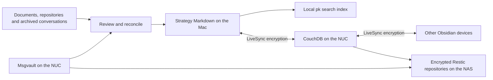

# Personal knowledge: Strategy

Strategy is Fran's maintained knowledge graph. Its source of truth is the
linked Markdown in `/Users/Papi/Repositories/project-knowledge/vaults/strategy/`,
starting at `Fran.md`, then `Personal` or `Work`. Obsidian displays these files;
agents read and edit the same files. There is no separate authoritative profile
in agent memory, Msgvault, a search index or Neo4j.

## How the pieces connect



Importing mail makes it searchable; it does not automatically turn its contents
into micronotes. Relevant facts are compared with existing notes and incorporated
through an explicit edit. Original messages and documents remain available for
checking a claim. Old plans and third-party statements do not establish current
facts by themselves.

The Mac is the agents' normal entry point, not a device that always wins sync
conflicts. LiveSync exchanges edits and deletions between participating devices.
The mobile onboarding files are prepared; a connected phone has not yet been
confirmed. [Obsidian](obsidian.md) covers adding and checking a device.

## Where everything lives

| Material | Location and role |
| --- | --- |
| Maintained notes | Mac: `/Users/Papi/Repositories/project-knowledge/vaults/strategy/` |
| Source catalogue | Same repository: `catalogues/strategy-sources.json`; maps notes to originals, message IDs and private exports |
| Private working data | Mac: `/Users/Papi/Library/Application Support/ProjectKnowledge/`; includes search data, review exports, local database files and credentials |
| Mail archive | NUC: `/var/lib/msgvault/`; SQLite, attachments and account configuration |
| Encrypted sync replica | NUC: `/var/lib/obsidian-sync/`; CouchDB database `strategy`, served through `https://api.beachlab.org/obsidian-sync` |
| Server backups | NAS: `/volume1/synology/backups/`, mounted on the NUC at `/mnt/nas-downloads/backups/` |

Linked originals also live outside these directories: in `Documents`, other
repositories and NAS folders. A catalogue entry or a `file://` link does not
copy its target into the vault. Local absolute links may work on the Mac but
cannot make those documents available on a phone.

Private notes stay in the vault's private sections. Their visibility labels are
organisational metadata, not access controls. A device receiving the whole vault
also receives its private notes. Passwords, tokens and private keys belong in
private configuration or credential storage, never in notes or Git.

## Reading and updating the graph

```bash
cd /Users/Papi/Repositories/project-knowledge
pk query strategy 'PiBot CAN hardware' --documents-only
```

Read the returned Markdown and follow its links. If the query misses a topic,
search the vault directly with `rg`, including exact names and synonyms.
Agents' global instructions point to this path even when their current project
is elsewhere; a remote agent without Mac filesystem access must report that
limitation instead of creating another vault.

Reuse the note for the subject. Write short English micronotes and link distinct
subjects from the relevant Personal or Work branch. Replace superseded statements
with the current state; Git keeps edit history. Past jobs, completed projects,
maintenance records and other purposeful histories retain their historical facts.
Keep source details in the catalogue and brief source links in the notes.

Each `pk query` refreshes the curated note index, including edits, renames and
deletions. Strategy's index is
`~/Library/Application Support/ProjectKnowledge/strategy/ingestion/documents.sqlite3`.
It is derived data, not a backup. Markdown search does not require a running
Neo4j server or a model. `pk ask` additionally passes retrieved text to Codex
through the configured ChatGPT session, so selected private passages can be
included in that request.

The separate Graphiti/Neo4j pilot runs through the Mac's `project-knowledge`
Colima profile. Its derived episodes do not override Strategy's curated notes.
Hariburi has its own vault and database; its generated `Fuentes/` pages remain
read-only. See [knowledge graphs and agent loops](knowledge-graphs.md) for the
experimental components.

## What is backed up

**CouchDB:** `obsidian-sync-backup.timer` runs daily at 02:55 Europe/Madrid,
with up to five minutes of delay. It briefly stops its container, captures data,
configuration and deployment files, restarts it, then encrypts the capture into
`obsidian-sync-restic` on the NAS. Retention is 7 daily, 4 weekly and 6 monthly
snapshots. [CouchDB recovery](obsidian.md#backups-and-recovery) explains the payload
and the separate device encryption key.

**Msgvault:** `msgvault-backup.timer` runs daily at 02:30 Europe/Madrid, also
with up to five minutes of delay. Msgvault creates a coherent native archive of
its database, attachments and recovery configuration before Restic transfers it
to `msgvault-restic`. Retention is 7 daily, 4 weekly and 6 monthly snapshots.
The native staging archive is private but unencrypted; the script removes it
only after the encrypted backup and checks succeed. See
[mail archive recovery](msgvault.md#storage-and-encrypted-backups).

These are separate repositories from the
[general NUC backup](backups.md#current-production-setup-restic). That backup
includes server configuration and other services; it does not capture the Mac's
Project Knowledge directory or replace either service-specific backup.

A backup's useful recovery point is when its source was captured, not when the
upload finished. Compare the successful snapshot with the service receipt before
assuming that a recent import or note edit is included:

```bash
ssh pink-sudo
systemctl list-timers msgvault-backup.timer obsidian-sync-backup.timer
sudo cat /var/lib/msgvault-backup/last-success.json
sudo cat /var/lib/obsidian-sync-backup/last-success.json
df -h /var/lib/msgvault /mnt/nas-downloads
```

In a root Bash shell on the NUC, inspect the actual encrypted snapshots:

```bash
export RESTIC_PASSWORD_FILE=/root/.config/thebeachlab-backup/restic-password
restic -r /mnt/nas-downloads/backups/msgvault-restic snapshots --tag msgvault
restic -r /mnt/nas-downloads/backups/obsidian-sync-restic snapshots --tag obsidian-sync
```

The Restic password has a recovery copy at
`/mnt/nas-downloads/backups/thebeachlab-restic-password`, protected by NAS share
permissions. This password opens the backup repositories; it is not LiveSync's
note-encryption key. A replacement NUC needs both NAS access and the appropriate
keys before recovery can begin.

### Mac files and remaining gaps

Time Machine is configured for the DiskStation `backups` share. Both the
Project Knowledge repository and its Application Support directory are included.
However, `tmutil latestbackup` currently fails to mount that destination, so a
recent complete Mac backup has not been established.

```bash
tmutil destinationinfo
tmutil isexcluded /Users/Papi/Repositories/project-knowledge \
  "$HOME/Library/Application Support/ProjectKnowledge"
tmutil latestbackup
```

The Project Knowledge Git repository currently has **no remote**. Its local
history protects against ordinary edits, but does not provide a second-device
copy. A complete Mac recovery needs the repository, including `.git` and the
catalogue, the private Application Support directory, and the linked original
documents. LiveSync excludes hidden configuration files and does not sync
external linked files or the source catalogue.

The LiveSync setup material is private at
`~/Library/Application Support/ProjectKnowledge/obsidian-sync/`.
`mobile-connection-private.txt` contains the device credentials, note-encryption
key and Setup URI password. That key is not in the NUC CouchDB backup. Retain
it in a separate protected recovery location; losing every device and this
Mac copy would leave only an encrypted replica. The local
`strategy-before-livesync-*.tar.gz` is a one-off vault snapshot, not a scheduled
full-system backup.

`pk backup strategy` is also narrower than its name might suggest: it stops the
local Strategy Neo4j instance, dumps the database, copies its events and ingestion
data under `strategy/exports/<timestamp>/`, then restarts it. It does **not**
back up the whole vault, catalogue, original documents, existing private exports
or credentials, and its output remains on the Mac unless copied elsewhere.

The NAS repositories are another-device protection for the NUC. They are not an
off-site copy. Hyper Backup is installed on the NAS, but the inspected job
configuration contains no tasks; no independent backup of these repositories
or the NAS source-document folders has been established.

## Recovering the system

### A note was changed or deleted

For one note, inspect Git history and recover its earlier contents into a
temporary file before editing the current note:

```bash
cd /Users/Papi/Repositories/project-knowledge
git log -- 'vaults/strategy/Private/Personal/PiBot.md'
umask 077
note_recovery_file=$(mktemp /tmp/PiBot-recovered-XXXXXX)
git show 'COMMIT:vaults/strategy/Private/Personal/PiBot.md' > "$note_recovery_file"
```

Replace `COMMIT` with the chosen revision. Compare with current work, restore the
needed content through the normal feature-branch workflow, and let LiveSync
propagate the deliberate edit. Git only contains committed versions. For an
uncommitted deleted file, check Obsidian recovery/Trash and other devices before
they propagate the deletion.

### The Mac or its disk was lost

1. Preserve every remaining device's local vault before reconnecting sync.
   Restore the repository and Application Support directory from a known-good
   Mac backup into a separate location first. Recover linked originals from
   their own backups too.
2. If only CouchDB survives, recover the device configuration and encryption key,
   create an empty vault and follow [the new-device procedure](obsidian.md#mac-and-mobile).
   This recovers the synced notes, not Git history, the catalogue, private exports
   or external originals.
3. Put the recovered repository at the canonical Mac path, inspect its Git state
   and source links, and follow its README to restore the `pk` environment.
   Retrieve a familiar topic with `pk query strategy ... --documents-only` to
   refresh and check search. Do not substitute old Neo4j output for missing notes.
4. Reconcile any newer notes from the preserved device copies. Re-enable other
   clients one at a time after checking `Fran`, private notes and representative
   links. Confirm an intentional edit travels in both directions.

### The NUC or a service database was lost

Recover NAS access and Restic credentials first. Choose explicit snapshots and
restore into fresh private directories. Use the focused procedures for
[CouchDB](obsidian.md#restore-couchdb) and
[Msgvault](msgvault.md#restore-the-mail-archive), preserving the existing live
directories until the replacements pass their checks. Keep Obsidian clients
disconnected while deciding which copy contains the newest notes.

Recovering CouchDB restores sync. Recovering Msgvault restores the source mail
and attachments. Neither operation restores the Mac catalogue or Git history.
Only resume normal syncing after comparing the selected recovery point with
newer device edits and any mail received after the archive capture.

Both backup scripts also require their repository identity files:
`/var/lib/msgvault-backup/repository.json` and
`/var/lib/obsidian-sync-backup/repository.json`. Preserve these private state
directories during recovery. They are outside the service snapshot payloads.
On a replacement host without them, first verify the expected NFS mount,
unlock the correct existing Restic repository and inspect its known snapshots.
Then save that repository's `restic cat config` output as the corresponding
root-only `repository.json`, in a mode-0700 state directory. Do not overwrite an
existing identity record or initialise a new repository in place of a missing
one. Check the first resumed backup succeeds before treating automatic protection
as restored.

### Only search stopped working

Check that the canonical vault is accessible and run the normal `pk query`
command. It refreshes the derived index from the saved Markdown. If the SQLite
index itself is damaged, preserve the entire `strategy/ingestion/` directory,
move it aside while no `pk` operation is running, and run the query again.
Keep the old directory until search works; never delete the vault to rebuild
an index.

Historical Neo4j recovery is a separate task using a compatible database dump
and the Project Knowledge README. It is not a prerequisite for reading,
editing or searching Strategy's notes.
